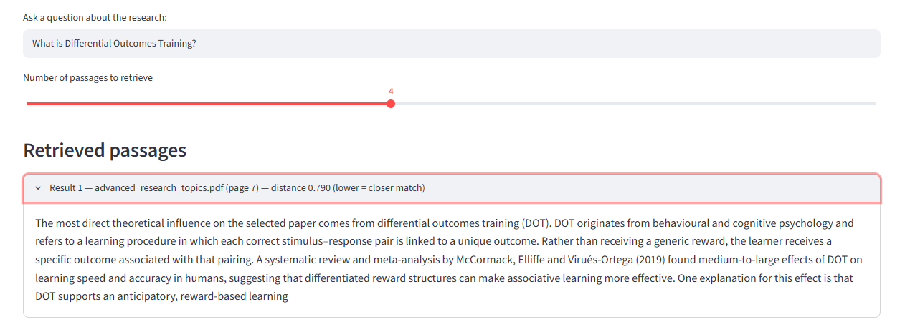

# Research Paper Q&A — A RAG System

A retrieval-augmented generation (RAG) search tool that answers questions about academic papers by retrieving the most relevant passages from the source PDFs, with the file and page number for every result.

Built as a self-directed project extending my MSc work in NLP and information retrieval.



## What It Does

Ask a natural language question and the system returns the most semantically relevant passages from the indexed documents, with the source file and page number for every result.

Unlike a keyword search, it matches on meaning — asking about "differential outcomes training" surfaces relevant discussion even where the exact phrase does not appear.

## How It Works

1. **Document loading** — PDFs parsed page by page using PyPDF
2. **Chunking** — split into 800-character chunks with 120-character overlap to preserve context across boundaries
3. **Embedding** — each chunk converted to a normalised vector using `sentence-transformers/all-MiniLM-L6-v2`
4. **Indexing** — vectors stored in a FAISS index for fast similarity search
5. **Retrieval** — the query is embedded and matched to the nearest chunks. Because the vectors are normalised, FAISS's distance ranks results the same way as cosine similarity; a lower distance means a closer match

## Quick Start

```bash
pip install -r requirements.txt
streamlit run app.py
```

The app indexes the PDFs in a `docs/` folder if there is one, otherwise the PDFs in the project folder. The repository includes sample PDFs from my MSc work.

## How I Checked It

I tested retrieval by asking questions whose answers I already knew from the papers, and checking that the right passages and page numbers came back.

## Design Decisions

**Retrieval only, no generation.** The system returns source passages rather than generating an answer. For academic material this is deliberate — every result is traceable to a page, and there is no risk of hallucinated content.

**Chunk size of 800 with overlap.** Academic writing carries arguments across sentences. Smaller chunks fragmented reasoning; the overlap prevents losing context at boundaries.

**MiniLM embeddings.** Runs locally with no API cost or latency, and performs well on this scale of corpus.

**Page numbers you can check.** PyPDF counts pages from 0, so the app shows each page's printed label, which means citations match the page numbers in the PDF.

## Engineering Notes

LangChain is now split into separate packages (`langchain-community`, `langchain-text-splitters`, `langchain-huggingface`), and the imports in `app.py` use these packages.

## Possible Extensions

- Add an LLM layer to synthesise retrieved passages into direct answers, with citations
- Hybrid search combining semantic and keyword (BM25) retrieval
- Re-ranking retrieved results with a cross-encoder
- Automated retrieval evaluation with a labelled question set or a framework such as RAGAS

## Tech Stack

Python · LangChain · FAISS · Sentence-Transformers · Streamlit · PyPDF

## Author

Dhanyashree Madappa Nethravathi — MSc Artificial Intelligence & Robotics, University of Hertfordshire
